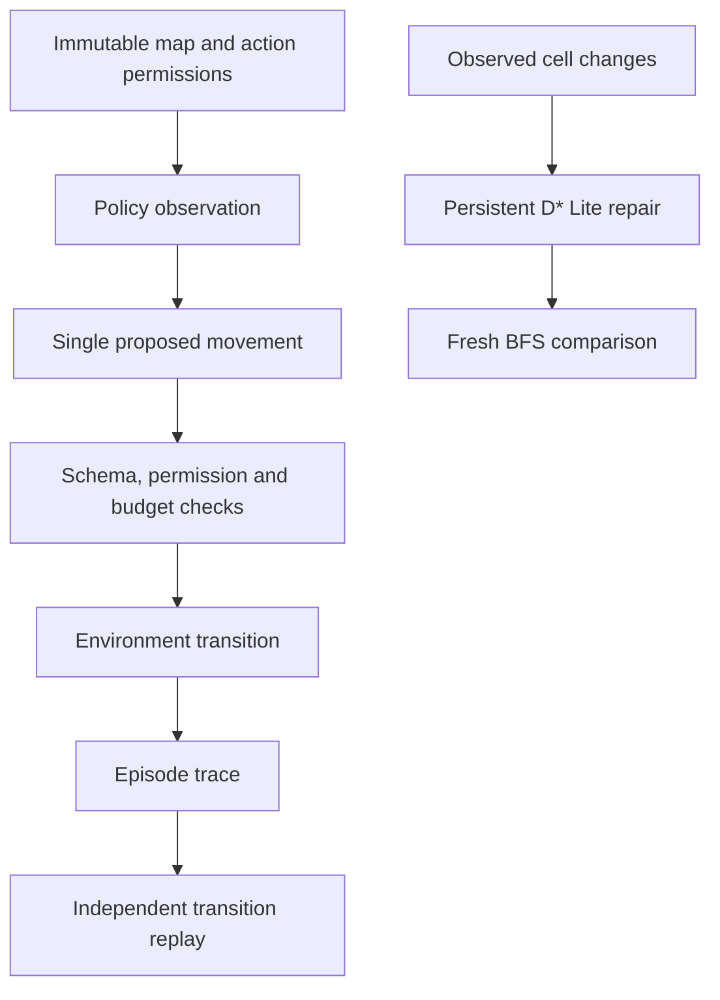

# Agent Arena

| Work across 156 repaired map snapshots | D* Lite | Repeated BFS |
| --- | ---: | ---: |
| Vertex expansions | 5,108 | 13,193 |
| Edge inspections | 102,522 | 52,268 |

Keeping search state reduced expansions in this experiment, but maintaining lookahead labels and extracting routes required more edge inspections. Both planners agreed on every optimal-cost or no-path result. These counters describe algorithm work, not a measured wall-clock speedup.

## Reproduce a repair sequence

```bash
python -m pip install -e .
python -m agent_arena replan-evaluate --output artifacts/replanning.json
```

This runs all 12 seeded scenarios behind the table above (156 snapshots). Add `--seed N` to run one scenario.

The replanning experiment closes and reopens routes, blocks and restores the goal, applies idempotent observations, and moves the start. D* Lite receives a full initial map plus a complete change feed. Its persistent `g/rhs` labels, keyed inconsistent-state queue and `km` correction survive those updates. A fresh BFS independently checks every repaired route.

```python
from agent_arena import CellChange, DStarLite, GridSnapshot

planner = DStarLite(GridSnapshot(7, 7, frozenset(), (5, 5)), (1, 1))
assert planner.repair()["path_length"] == 8
planner.apply_changes([CellChange((5, 5), True)])
assert planner.repair()["status"] == "no_path"
planner.apply_changes([CellChange((5, 5), False)])
planner.move_start((2, 1))
assert planner.repair()["path_length"] == 7
```

The goal stays fixed and edges have unit cost. Arbitrary weights, hidden map changes and moving targets are outside this planner's contract.

## Compare policies under visible observation rules

The navigation arena is a second experiment:

```bash
python -m agent_arena evaluate --output artifacts/navigation.json
python -m agent_arena replay --input artifacts/navigation.json --output artifacts/replayed.json
```

| Policy | Observation | Recorded release success |
| --- | --- | --- |
| Reactive Manhattan baseline | Full map | 3/12 |
| BFS planning oracle | Full map | 12/12 |
| DFS explorer with episode memory | Four neighboring cells | 12/12 |

The DFS information budget differs from the full-map policies. Its longer paths measure exploration, not model quality under equal information. An optional local causal-model adapter has strict action parsing and call budgets; checkpoint inference remains unrun. The default code uses Python's standard library and classical search.



## Where to look

- `src/agent_arena/incremental.py`: queue keys, local consistency and repair.
- `src/agent_arena/arena.py`: worlds, observations and the movement boundary.
- `src/agent_arena/replay.py`: independent episode checks.
- `scenarios/`: adversarial worlds, differential repairs and policy-boundary tests.
- `rulesets/`: the procedural split manifest.
- `transcripts/`: navigation episodes and recorded repair traces.
- `arena-notes/`: [search design](arena-notes/search-and-memory.md), [policy catalog](arena-notes/policy-catalog.md) and [work measurements](arena-notes/repair-work-measurements.md).

The recorded navigation report passed 56/56 invariants and 56/56 transition replays. Replanning matched BFS on 156/156 snapshots, including 30 no-path cases. The full suite contains 51 tests, including 1,000 generated differential repairs. [Scenario checks](arena-notes/scenario-checks.md) distinguish those results from the unrun local-model path.

```bash
python -m pip install -e . -r requirements-dev.txt
PYTHONPATH=src python -m unittest discover -s scenarios -v
python dev/check_arena.py --require-lint --wheel
```

Episode deadlines are cooperative checks around trusted synchronous policies; they cannot interrupt a hung native call. The mazes, observation limits and published seeds are part of each report, so a new policy should use a fresh holdout after development. The [map and agent boundary](arena-notes/map-and-agent-boundaries.md) and [trace audit](arena-notes/trace-audit.md) spell out the remaining assumptions.
