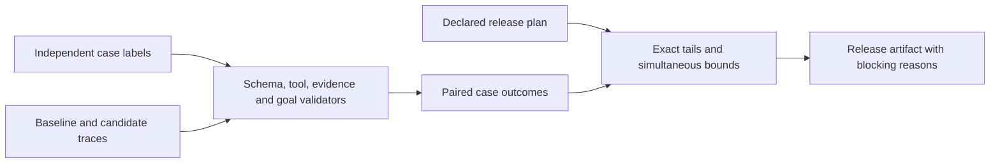

# Agent Regression

<!-- at-a-glance -->
[](https://github.com/pavan139/agent-regression/actions/workflows/ci.yml) 

| | |
| --- | --- |
| **Problem** | Agent release decisions that only check the final answer miss wrong tools, repeated side effects and invented evidence. |
| **Result** | Caught **128/128** injected faults across 8 fault types on a deterministic fixture agent; 21/21 baseline contracts pass. |
| **Try it** | `pip install -e .` then `python -m agent_regression compare --baseline baselines/baseline.jsonl --candidate baselines/candidate-regression.jsonl --output results/comparison.json` |
<!-- /at-a-glance -->


A correct answer is insufficient when the agent used the wrong tool, repeated an effect, or invented its evidence. This suite grades the visible output and execution trace against independent arithmetic labels, then compares complete runs before making a release decision.

## Run a failing comparison first

```bash
python -m pip install -e .
python -m agent_regression compare --baseline baselines/baseline.jsonl --candidate baselines/candidate-regression.jsonl --output results/comparison.json
```

The supplied candidate deliberately breaks `add-positive`. Exit status **1** is the expected result for that comparison. Comparing the baseline to itself exits 0. Missing cases block the gate instead of disappearing from the denominator.

To generate and grade the local fixture:

```bash
python -m agent_regression evaluate --output results/evaluation.json --export-traces results/baseline.jsonl
python -m agent_regression evaluate --replay results/baseline.jsonl --output results/replayed.json
```

The fixture is a deterministic arithmetic agent with four allowlisted tools. It makes no model calls. Its 21 labeled cases and eight named executable faults exercise the harness; they are not a measurement of LLM reasoning.

## Release inference has a separate plan

A statistical comparison binds the labeled dataset, baseline/candidate versions, replay hashes, declared slices, minimum sample sizes and critical cases:

```bash
python -m agent_regression release-demo --output results/release-experiment.json
python -m agent_regression release --cases suites/release-cases.jsonl --baseline baselines/release-baseline.jsonl --candidate baselines/release-candidate.jsonl --plan suites/release-plan.json --output results/release.json
```

The supplied 240-case synthetic run recorded 213 baseline successes and 232 candidate successes. A separately versioned candidate with a critical-case fault is blocked. Exact McNemar/binomial tails and Holm correction test deterioration; conservative simultaneous bounds support the noninferiority check. Bootstrap intervals are descriptive and do not authorize release by themselves.

These are fixed-sample calculations over independent case pairs. Repeated peeking, clustered cases and selecting slices after seeing outcomes require different inference. [The release mathematics](handbook/paired-release-inference.md) states the assumptions and alpha allocation.



## What belongs in a replay

Every successful record has a typed answer, the selected tool, a call ID and the actual observable tool event. Unknown fields, duplicate executions, forged evidence, malformed errors and unbounded input fail validation. Imported traces are checked for internal consistency; the file format does not attest that another system actually executed them.

Fault reports distinguish attempted, unchanged, ineligible and detected injections. Existing baseline failures cannot increase the mutation score. The recorded fixture run passed 21/21 baseline contracts, detected 128/128 eligible named faults and passed 48/48 paired metamorphic cases. The complete suite contains 44 tests.

```text
src/agent_regression/harness.py    Cases, fixture, mutations and replay grading
src/agent_regression/statistics.py Paired release inference
checks/                            Behavioral and statistical regressions
suites/                            Labeled cases and declared plans
baselines/                         Recorded traces and candidate examples
handbook/                          Replay contract, findings and results
scripts/check_suite.py             Standalone package verification
```

The [replay format](handbook/replay-format.md) and [validator findings](handbook/validator-findings.md) explain the edge cases. [Fault-probe results](baselines/review-fault-probes.json) preserve selected source-fault probes without presenting them as whole-project mutation coverage.

```bash
python -m pip install -e . -r requirements-dev.txt
PYTHONPATH=src python -m unittest discover -s checks -v
python scripts/check_suite.py --require-lint --wheel
```

Python 3.11+ is sufficient. [Running the gates](handbook/running-the-gates.md) covers interpretation; [sharing a suite](handbook/sharing-a-suite.md) covers release files. A different tool environment needs its own independent oracle and labels before these checks can grade it.
