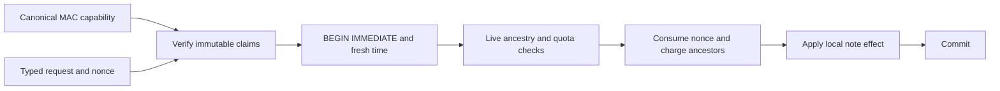

# Capability Guard

<!-- at-a-glance -->
[](https://github.com/pavan139/capability-guard/actions/workflows/ci.yml) 

| | |
| --- | --- |
| **Problem** | An LLM agent can be talked into calling tools it should not; a valid credential can still be unusable. |
| **Result** | HMAC-signed, attenuable capabilities with quotas, revocation and replay protection; **17** adversarial tests. |
| **Try it** | `pip install -e .` then `python -m capability_guard demo --output artifacts/receipt.json` |
<!-- /at-a-glance -->


An authentic credential can still be unusable. Its MAC may verify after its quota is exhausted or its issuer key is revoked. The distinction is the main interface in this library:

```text
verify(token)             encoding + MAC + identity + time
execute(token, request)   live authorization + nonce + quota + local effect
```

The trusted host issues HMAC-SHA256 capabilities for three fictional note operations. An agent can propose a typed request; it cannot grant itself a scope by putting instructions in the text. Issuance, attenuation, rotation, and revocation stay outside the tool allowlist.

## Exercise the boundary

Python 3.11+ and its standard library are sufficient.

```bash
python -m pip install -e .
python -m capability_guard demo --output artifacts/receipt.json
python -m capability_guard evaluate --output artifacts/contracts.json
python -m unittest discover -s adversarial -v
```

The demo appends 24 bytes, rejects a repeated nonce, and rejects an ungranted resource. Keys, bearer credentials, and the database are temporary. The saved [receipt](receipts/demo.json) contains no key or bearer token.

## Host-side use

```python
from pathlib import Path
import secrets
import tempfile
from capability_guard import Authority, Operation

with tempfile.TemporaryDirectory() as directory:
    authority = Authority(Path(directory) / "policy.db")
    authority.add_key("key-one", secrets.token_bytes(32))
    token = authority.issue(
        scopes=["note:append"], resources=["lab/public"],
        max_calls=2, max_units=32, max_bytes=16, ttl=60,
    )
    receipt = authority.execute(
        token, Operation("note:append", "lab/public", "bounded text"),
        nonce=secrets.token_hex(16),
    )
```

`attenuate()` is issuer-controlled reissuance. Children may narrow scope, resources, lifetime, and budgets. Every child invocation charges all ancestors, so splitting a grant into children cannot multiply its quota. A child also depends on every ancestor and key remaining active.

## Where the effect becomes committed



The nonce, quota updates, and effect share one SQLite transaction. A request waiting behind a write lock sees a revocation committed before it proceeds. Expiry is reread after the wait. Storage failure rolls back the whole invocation; a lost response after COMMIT remains a caller ambiguity, rather than a distributed exactly-once guarantee.

## Code and evidence

```text
src/capability_guard/authority.py   claims, MACs, policy and SQLite transaction
adversarial/test_authority.py      forgery, replay, races and rollback cases
policies/                         host-policy and request boundary notes
receipts/                         credential-free example reports
security/                         threat model, rules and check records
scripts/review_mutations.py        three targeted regressions in copies
scripts/check_authority.py         repository checker
```

Start with [credential and quota rules](security/credential-and-quota-rules.md), then the [transaction boundary](security/transaction-boundary.md). The [authorization regressions](security/authorization-regressions.md) and [replay trials](security/replay-and-quota-trials.md) record 17 passing contracts and the exercised concurrency cases.

The host process, keys, clock, SQLite store, and filesystem are trusted. HMAC uses a shared secret, not public-key signatures. The subject denotes a host context, not a human login. A stolen bearer can spend its remaining rights. Arbitrary code execution or direct database edits bypass this library; logical tool limits are not an OS sandbox. Only this database's local effects participate in the transaction. Never print or commit issuer keys, bearer credentials, or private database contents.
