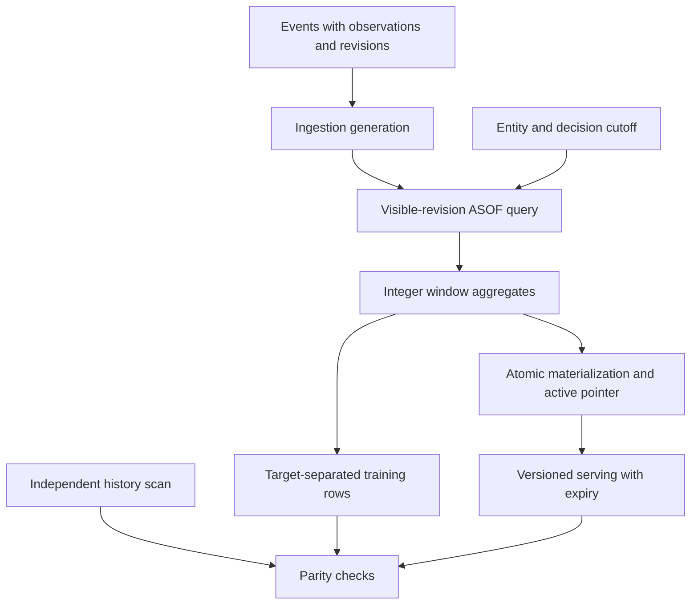

# Chronofeature

A purchase happened at time 10 but was first observed at time 15. A decision at time 12 must not use it. A decision at time 20 may.

Event time alone cannot answer that question. Chronofeature keeps observation time and ingestion generation alongside each immutable event revision, then applies all three cutoffs before building a feature.

```python
from chronofeature.feature_store import Event, FeatureStore, Label, Query, Spec

store = FeatureStore("features.sqlite")
store.ingest([Event("purchase-1", "alice", event_time=10, observed_at=15, value=250)])
earlier = store.query(Query("alice", label_time=12), Spec())
later = store.query(Query("alice", label_time=20), Spec())
training = store.offline_join([Label("example-1", "alice", 20, target=1)])
store.materialize("version-1", ["alice"], as_of=20)
served = store.serve("alice", now=20)
```

The target stays outside feature queries. `source_generation=` can reproduce a historical ingestion snapshot after backfills. Previously published versions remain immutable.

## Query semantics

| Boundary | Selection rule |
| --- | --- |
| Decision time | Event time and declared observation time must both be visible |
| Revision | Highest available revision, not a future correction |
| Rolling window | `(label_time - window, label_time]` |
| Equal event times | Deterministic event-ID order |
| Source generation | Exclude physically later ingestion when requested |

SQLite resolves visible revisions with an indexed ASOF query. Integer prefix sums and binary-search cutoffs compute count, sum, mean, and latest value across configured windows. The [point-in-time rules](reference/point-in-time-rules.md) define exact boundaries and complexity. Availability timestamps are source declarations; the engine cannot detect a dishonest source clock.



## A served value has a timestamp

Serving returns the materialization time, source generation, and specification hash. It does not recompute aggregates at each request. A cached window expires at the earlier relevant TTL or membership boundary; once an included event falls out of the window, its old sum cannot remain available merely because the latest event is fresh.

New arrivals may require refreshing a still-unexpired snapshot. Publishing a new version writes all entity rows, metadata, and the active pointer in one transaction. Replaying an older version cannot move that pointer backward. A changed definition needs a new `(name, version)` specification identity.

## Run the temporal examples

```sh
python -m pip install -e .
python -m chronofeature evaluate --config feature_specs/experiment.json --output artifacts/parity.json
python -m unittest discover -s test -v
```

The [recorded run](worked_examples/evaluation.json) checks 120 independent scan comparisons plus 18 generation, target-isolation, atomicity, replay, and expiry cases: **138/138 invariants**. Its 112 initial revisions include corrections and tombstones, followed by backfills. The tests also run seeds 23 and 101. No model accuracy or serving-throughput result is inferred from these checks.

```text
feature_specs/experiment.json           seeded temporal workload
src/chronofeature/feature_store.py       query, join, and materialization
src/chronofeature/oracle.py              independent revision/window scan
test/test_features.py                   boundaries and parity
worked_examples/                       recorded training and serving responses
reference/                             query and publication rules
scripts/check_features.py              package verification
```

[Feature flow](reference/feature-flow.md), [temporal regressions](reference/temporal-regressions.md), and [parity runs](reference/parity-runs.md) cover the implementation. The store uses integer-valued signals and local SQLite transactions. Distributed cache invalidation, streaming watermarks, and automatic refresh are not implemented.
