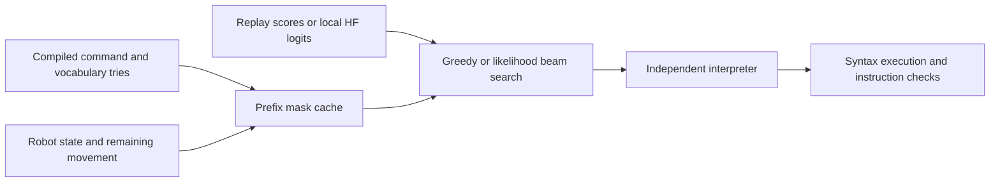

# Constrained Generation

`MOVE N 3;STOP` parses, but it walks off a 5x5 board when the robot starts in the center. `STOP` is safe and well formed, but it does not carry out an instruction to move east. This project keeps those failures separate while comparing unconstrained decoding, grammar masks, and state-aware masks.

The language is deliberately small:

```text
program := command{0,8} STOP
command := MOVE direction steps; | PICK item; | DROP item;
direction := N | E | S | W
steps := 1 | 2 | 3
item := a | b | c
```

Spacing is literal, as in `MOVE E 2;PICK a;STOP`. The interpreter checks position, item ownership, and a six-cell movement budget. Programs cannot invoke Python, a shell, or external tools.

## Follow one decoding run

```bash
python -m pip install -e .
python -m constrained_generation demo
python -m constrained_generation beam-evaluate --count 20 --beam-width 4 --token-budget 128 --output artifacts/beams.json
```

Python 3.11+ is sufficient for the replay experiments. The synthetic policy assigns preferences to known candidate strings; it is not a language model. Every approach sees the same scores, including the reference completion. Reports retain syntax validity, executability, final state, action-aware instruction success, and exhausted budgets.

The [recorded beam run](cases/beam-evaluation.json) illustrates a search-objective problem:

| Approach, 20 cases | Syntax valid | Executable | Instruction success |
| --- | ---: | ---: | ---: |
| Unconstrained greedy | 11 | 3 | 3 |
| Compiled grammar beam | 20 | 20 | 2 |
| Compiled semantic beam | 20 | 20 | 2 |

A short `STOP` can outrank a longer correct answer under raw sequence likelihood. The search does not add an undisclosed length bonus to hide that result. [The experiment note](spec/compiled-decoding-evidence.md) records candidate expansions, policy calls, and the exact setup.

## Where the constraints enter



The compiled machine carries grammar position, completed-command count, robot state, and movement budget. A shared vocabulary trie avoids checking every token against every full prefix. Semantic masking uses the initial state and legal actions; it never reads the expected program or goal. Accepted prefixes have executable continuations, but a token cap can still end a run before completion.

Beam scores include EOS and use the original conditional log probabilities, without renormalizing after masking. Completed hypotheses are retained separately. Narrow beams are not guaranteed to recover the globally most likely program.

## Local checkpoint comparisons

```bash
python -m pip install -e '.[ml]'
python -m constrained_generation hf-beam-evaluate --model /absolute/path/to/checkpoint --beam-width 4 --count 20 --token-budget 128 --output artifacts/hf-beams.json
```

Known standalone ByteLevel decoders use compiled masks. Other tokenizers use a full-suffix reference path; `--force-reference` makes that comparison explicit. Sparse vocabulary IDs and model-output bounds are checked. Inherited forced-EOS and minimum-length settings cannot override the mask. Loading is local-only, and the scorer recomputes prefixes rather than claiming KV-cache acceleration.

Random tiny-checkpoint integration tests have run. No useful pretrained-model score is supplied.

## Files worth opening

```text
src/constrained_generation/   grammar, interpreter, compiled masks and search
presets/decoder_cases.json    replay settings
cases/                       DSL examples and recorded runs
spec/automata-and-search.md   state machine and scoring derivation
spec/decoder-defects.md       reproduced bugs and their regression tests
devtools/check_decoder.py    repository checks
```

Run `python -m unittest discover -s tests -v`. With the optional ML dependencies installed, use `RUN_ML_SMOKE=1` to include the local-checkpoint tests. For wheel and formatting checks, run `python devtools/check_decoder.py --require-lint --wheel`.

The [state map](spec/language-and-states.md), [trial protocol](spec/beam-trials.md), and [check record](spec/check-record.md) describe the rest of the evidence. Historical trace paths refer to the layout used when those runs were recorded.
