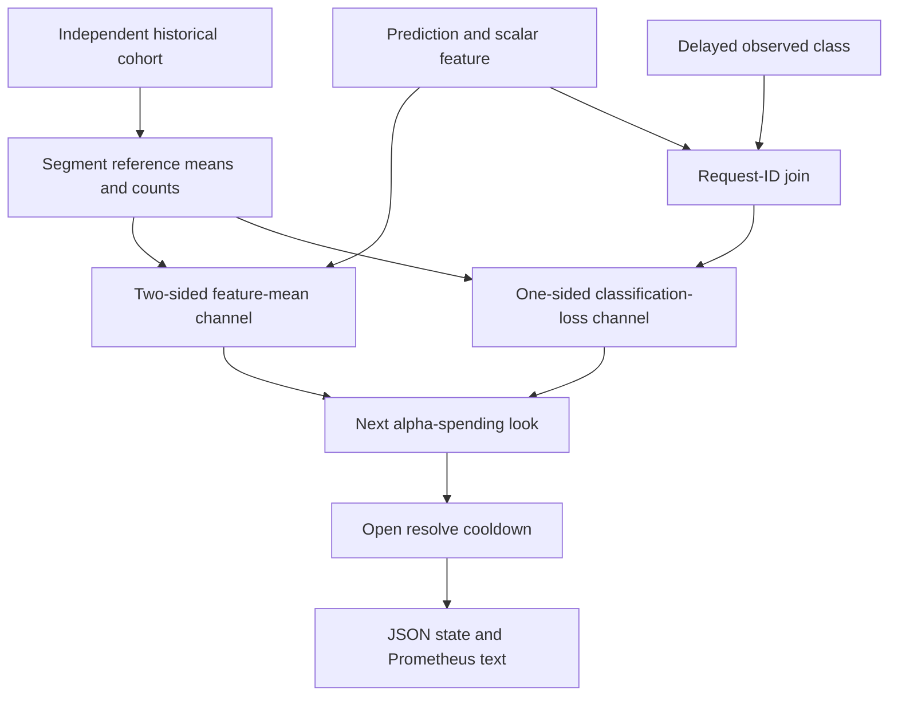

# Drift Sentinel

Twenty-four stationary trajectories produced no alert openings in the saved run. Their approximate 95% interval still reaches 0.138. That gap matters: a quiet small experiment does not establish zero false-alert risk.

The same experiment detected all 24 feature-mean shifts and all 24 classification-loss increases, with median delays of 255 and 270 request indices. Those are separate signals. A changed input mean says something about incoming data; worse predictions require joined outcomes.

## Reproduce the measurements

```bash
python -m pip install -e .
python -m drift_sentinel evaluate --output artifacts/evaluation.json
python -m drift_sentinel demo --output artifacts/demo.json --metrics-output artifacts/metrics.prom
python -m drift_sentinel metrics --output artifacts/metrics.prom
```

The [trajectory record](measurements/evaluation.json) keeps the seeds, sample counts, stream fingerprints, censoring and per-scenario results. Each trajectory has 2,048 predictions, independent historical calibration and labels delayed by 0 to 31 indices. Its thresholds were not tuned on those evaluation seeds. The [change-trajectory notes](analysis/change-trajectories.md) give the full setup and limits.

## An outcome becomes observable at the join

```python
from drift_sentinel import Label, Monitor, Prediction
from drift_sentinel.experiments import baseline

# The helper creates a fictional historical cohort. For your own data,
# use calibrate(historical_predictions, historical_labels).
monitor = Monitor(baseline(seed=100017))
monitor.label(Label("request-1", observed_label=1), at=0)
monitor.prediction(Prediction("request-1", 1, 0.45, "a", predicted_label=0))
print(monitor.snapshot()["joined"])  # 1
print(monitor.prometheus())
```

A label can precede or follow its prediction. Their request ID binds the pair, and the join computes classification error once. An unlabeled prediction contributes its feature value but no invented quality result. Identical duplicates are idempotent; conflicting duplicates and exhausted pending-state capacity fail explicitly.



## Read an alert in context

Each metric/segment gets a fixed part of the monitoring epoch's alpha budget. Look `j` spends that part times `6/(pi² j²)`. The two-sample boundary includes the finite historical reference's uncertainty. Opening requires consecutive positive looks; resolution uses a narrower exit band, followed by cooldown. None of those transitions resets the spending clock.

The false-opening bound assumes independent stationary bounded observations, an independent historical cohort, and noninformative label arrival. It is unconditional over reference and future sampling. It does not hold conditionally for every realized reference. Informative missing labels change the population represented by observed quality.

This monitor tracks mean shifts. A variance change with the same mean may remain invisible. It is also in-memory: a fresh instance starts another epoch, so repeated restarts need a higher-level error budget. The demo's global quality alert opens at index 400 and resolves at 718; segment recovery can take longer.

## Work on the monitor

Python 3.11 or later is sufficient; the runtime has no external dependencies.

```bash
PYTHONPATH=src python -m unittest discover -s tests -v
python tools/check_monitor.py --require-lint --wheel
```

The 14 tests include 54 independently enumerated small-sample null checks, alpha-budget summability, delayed joins, hysteresis/cooldown and finite text exports.

- `src/drift_sentinel/monitor.py` contains the joins, channels and alert state.
- `monitoring/default.json` records the default settings.
- `measurements/` holds JSON and Prometheus output from executed runs.
- [Spending and delay](analysis/spending-and-delay.md) derives the statistical assumptions.
- [Observation path](analysis/observation-path.md) and [null/lifecycle checks](analysis/null-and-lifecycle-checks.md) locate the state transitions and tests.
