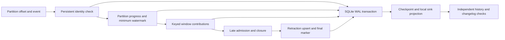

# Eventflow

A late value changes an already published window. Replaying that source record leaves the corrected result alone. The small stream in `streams/stream.jsonl` makes both behaviors visible:

| Input step | Watermark/result for `[0,10)` |
| --- | --- |
| Values 3 and 4 arrive from separate partitions | Both contribute to count 2, sum 7 |
| Both partitions advance to event time 12 | Watermark 10 emits sum 7 |
| A value 5 arrives with event time 4 | Retract sum 7, then upsert count 3, sum 12 |
| The same partition/offset is replayed | Duplicate; no extra contribution |
| Both partitions advance to 17 | Watermark 15 finalizes the window |
| A value 99 arrives for that closed window | Dropped under the lateness policy |

These steps use lag 2 and allowed lateness 5. Online features and inference telemetry need this sort of policy whenever source time, arrival order and retries disagree.

## Keep a checkpoint, then replay the source

```bash
python -m pip install -e .
python -m eventflow run --input streams/stream.jsonl --config streams/default.json --database artifacts/checkpoint.sqlite --output artifacts/first.json
python -m eventflow run --input streams/stream.jsonl --config streams/default.json --database artifacts/checkpoint.sqlite --output artifacts/replayed.json
```

The first command commits ten unique records and sees one duplicate. The second sees eleven duplicates and leaves checkpoint/sink state unchanged. Each source input is its own transaction, so a failed input does not undo the earlier committed prefix.

A source identity is `(partition, offset)`. Offsets may have gaps or arrive out of numeric order. The processor records the exact identity and payload fingerprint; reusing an identity with different content raises a conflict.

## Follow an event through the transaction



Windows are half-open and aligned to `slide`. Setting slide equal to window size produces tumbling windows; smaller slides overlap. One event can be closed out of an older sliding window while still contributing to a newer one.

The watermark is the minimum progress across all configured partitions, less the allowed out-of-orderness. An unseen or stalled partition holds it back. `advance` records are explicit source progress assertions, not a guessed idle-partition timeout. A window closes inclusively at `end + allowed_lateness`.

Source identities, progress, aggregate state, sink changes and checkpoint metadata commit together. A crash before commit rolls them back; a crash after commit is handled by replay deduplication. The guarantee ends at the local SQLite database. A remote broker or consumer needs its own acknowledgement and idempotency protocol.

## Inspect recovery evidence

```bash
PYTHONPATH=src python -m unittest discover -s recovery_tests -v
python -m eventflow demo --output artifacts/demo.json
python -m eventflow evaluate --output artifacts/evaluation.json
```

The 17 tests include a crash during a late sink revision, atomic capacity failures and maximal-timestamp draining. The saved [evaluation](traces/evaluation.json) passed 30/30 scenarios across window/lateness policies, both commit boundaries and twelve seeded out-of-order streams. Its oracle retains individual contributions and recomputes sums independently; a second consumer rebuilds the sink from duplicate-delivered changelog entries.

State has finite limits. Closed active windows are evicted, while source identities and final sink rows remain until the application's retention boundary. Reaching a configured capacity rolls back the current input rather than silently losing replay identity. [The watermark contract](protocol/watermark-contract.md) lists those bounds and the storage assumptions.

| Location | Purpose |
| --- | --- |
| `src/eventflow/processor.py` | Window state and local transaction |
| `src/eventflow/oracle.py` | Contribution-history oracle and changelog consumer |
| `recovery_tests/` | Boundary, replay and crash tests |
| `streams/` | Runnable source and policy |
| `traces/` | Recorded window and replay histories |

[Event to sink](protocol/event-to-sink.md) maps the components; [window histories](protocol/window-histories.md) records the workloads. Run `python dev/check_recovery.py --require-lint --wheel` for the full installation check.
