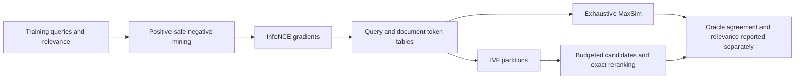

# Hard-negative retrieval

<!-- at-a-glance -->
[](https://github.com/pavan139/hard-negative-retrieval/actions/workflows/ci.yml) 

| | |
| --- | --- |
| **Problem** | Approximate indexes trade recall for speed, and perfect candidate recall still does not make a ranking correct. |
| **Result** | Index recall@5 vs exhaustive MaxSim rises from **0.74** (1 probe, 16 candidates) to **1.00** (8 probes, 96 candidates). |
| **Try it** | `pip install -e .` then `python -m hard_negative_retrieval index benchmark --epochs 8 --clusters 8 --queries 128 --artifact-directory artifacts/index --output artifacts/index-results.json` |
<!-- /at-a-glance -->


Probing every index cluster reproduces the exhaustive ranking. That does not make the ranking correct.

On the recorded 96-document corpus, exhaustive MaxSim places the relevant document first for **74/128 queries**: 64/64 alias questions and 10/64 relation-binding questions. The latter swap roles while keeping the same token multiset. Non-contextual token vectors cannot distinguish those documents, even with perfect candidate recall.

| Index setting | Agreement recall@5 with exhaustive MaxSim | Mean token dot products |
| --- | ---: | ---: |
| One probe, 16 candidates | 0.74375 | 482.875 |
| Two probes, 96 candidates | 0.921875 | 2066.3125 |
| Eight probes, 96 candidates | 1.0 | 3836.0 |

[Per-query index results](reports/index-benchmark.json) keep relevance separate from agreement with the scoring oracle. [Late-interaction results](method/late-interaction-results.md) explain the difficult slice and measured work.

## Reproduce the comparison

Python 3.11+ is sufficient for the training and index code. There are no required third-party packages.

```sh
python -m pip install -e .
python -m hard_negative_retrieval index benchmark --epochs 8 --clusters 8 --queries 128 \
  --artifact-directory artifacts/index --output artifacts/index-results.json
python -m hard_negative_retrieval index search --dataset artifacts/index/dataset.json \
  --checkpoint artifacts/index/model.json --index artifacts/index/index.json \
  --query 'Within project0 find the rule allowing blue teams to export tables' \
  --probes 2 --max-candidates 16
```

The coarse partition uses spherical k-means++. Candidates are reranked by the same normalized-token MaxSim function as exhaustive search. Saved indexes bind the corpus and both raw and normalized encoder state. Loading rejects stale bindings, missing or duplicate postings, nonfinite centroids, and inconsistent assignments.



## Encoder training and its easier benchmark

```sh
python -m hard_negative_retrieval evaluate --config experiments/configs/default.json \
  --ablation --checkpoint artifacts/model.json --output artifacts/negative-strategies.json
python -m hard_negative_retrieval evaluate --load-checkpoint artifacts/model.json \
  --output artifacts/reloaded.json
python -m unittest discover -s tests -v
```

The dual encoder learns separate mean-pooled token tables with InfoNCE and SGD. Hard mining begins with lexical negatives and then uses model rankings; the random-negative ablation excludes the same known positives and preserves update order. Development and test labels do not enter training.

On the 32-document template benchmark, both negative strategies reach Recall@1 of 1.0 on 64 test queries. This workload gives no evidence that hard negatives outperform random negatives. It shares products, intents, aliases, and corpus text across query-template splits. The [reference data and results](benchmarks/reference/evaluation.json) retain that narrower interpretation.

## Where to look

```text
src/hard_negative_retrieval/model.py             encoder, gradients, checkpoints
src/hard_negative_retrieval/late_interaction.py  MaxSim and IVF search
experiments/configs/default.json                training settings
benchmarks/reference/                          seeded data, weights, and prior runs
tests/                                         numerical, split, and index checks
method/                                        scoring rules and experiment notes
bin/check_retriever.py                          standalone verification entry point
```

[Scoring and partition rules](method/maxsim-and-partitions.md) cover complexity and artifact validation. [Encoder/index flow](method/encoder-and-index.md) describes component boundaries. [Numerical checks](method/numerical-checks.md) records regressions, and [retrieval runs](method/retrieval-runs.md) lists comparison commands.

Text is bounded to 5,000 characters and 128 retained tokens; the corpus supports at most 1,000 documents. Training and query work have explicit limits. Unknown-only learned queries return no hits. These token vectors are neither contextual transformer outputs nor parameters trained with a MaxSim objective. The optional sentence-transformers adapter is separate and unmeasured here. Sharing a new corpus or index requires the identities and split information described in [the index release notes](method/sharing-an-index.md).
