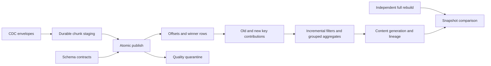

# Incremental lakehouse

A batch is staged before it is published. That separation lets ingestion resume after a partial write without exposing half-updated analytical tables.

The publish transaction advances source offsets, selects current rows, maintains derived views, records quarantine, and moves the batch checkpoint together. A failed publish leaves the staged input available for retry. Readers keep seeing the previous committed snapshot.

## Publish an order change

```sh
python -m pip install -e .
python -m incremental_lakehouse demo --config contracts/experiment.json --output artifacts/publish.json
```

The same path is available through the Python API:

```python
from incremental_lakehouse.contracts import Event
from incremental_lakehouse.warehouse import Warehouse

warehouse = Warehouse("warehouse.sqlite")
change = Event("orders_source", "p0", 0, "orders", "order_1", "upsert", 100, 1,
               {"id": "order_1", "entity": "alice", "amount_cents": 250, "status": "paid"})
warehouse.stage("batch-1", [change])
warehouse.publish("batch-1")
print(warehouse.snapshot())
```

`stage` stores the immutable payload and durable chunk cursor. `recover(batch_id)` finishes incomplete staging and publishes. Reusing a batch ID with different content fails. Exact published replays return the stored report.



## Decide what a change means

Offsets are contiguous per source/partition. An exact replay is ignored; a conflicting payload at the same offset or a gap rejects the batch. Cursor progress is separate from row version: a late valid event can consume an offset while leaving the winning row unchanged.

Winner ordering is `(event_time, source, partition, offset)`. Deletes retain tombstones, so an older backfill cannot resurrect a deleted key. This is a declared conflict policy; a source needing another policy must change the contract explicitly.

Row and quality errors enter quarantine and consume their offset. Unknown tables and incompatible schema changes abort publication. Evolution permits additive nullable/defaulted fields, relaxed nullability, and integer-to-float widening. Source rows are normalized through their declared schema before applying the current one.

Derived filters and grouped sum/count models consume coalesced old/new key contributions. Group transfers, refunds, and deletes subtract the old contribution and add the new one. An unchanged view does not invent a new content generation or invalidate descendants. The [CDC and view rules](design/cdc-and-view-rules.md) specify rational accumulation, schema checks, lineage, and complexity.

## Inspect a run

```sh
python -m incremental_lakehouse evaluate --config contracts/experiment.json --output artifacts/evaluation.json
python -m unittest discover -s tests -v
```

The [seed-17 run](fixtures/evaluation.json) consumes 120 unique events in 12 published batches: **53/53 invariants**, seven quarantines, 11 exact duplicates, and 26 older valid versions ignored. Every batch is compared with an independent full-history rebuild. These are controlled correctness results, not throughput measurements.

```text
contracts/experiment.json                 workload seed
src/incremental_lakehouse/contracts.py     CDC and schema definitions
src/incremental_lakehouse/warehouse.py     staging, publication, and deltas
src/incremental_lakehouse/oracle.py        independent rebuild
fixtures/                                executed snapshots and reports
design/                                  publication and recovery notes
maintenance/check_publish.py             release checks
```

[Publication flow](design/publish-path.md), [recovery cases](design/recovery-cases.md), and [change-stream runs](design/change-stream-runs.md) describe the boundaries exercised by tests. Batches, retained offsets/keys, schema changes, and DAG nodes have explicit caps. SQLite serializes writers; external source acknowledgements do not join its transaction. No distributed scheduler, object-store connector, retention service, or remote source is included.
