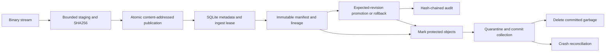

# Model Ledger

Two release jobs can both read staging revision zero. Only one should publish revision one. Model Ledger makes that decision with a compare-and-swap transaction and records the winning release in a hash-chained audit log.

```python
from model_ledger import LedgerError, Registry

with Registry("artifacts/registry") as ledger:
    blob = ledger.put(b"example-weight-bytes")
    model = ledger.create_manifest("classifier", "model", [blob.sha256], expected_version=0)
    release = ledger.promote("staging", model["id"], expected_revision=0)
    print(release["revision"])

    try:
        ledger.promote("staging", model["id"], expected_revision=0)
    except LedgerError as error:
        print(error.code)  # stale_revision
```

Use a fresh registry directory for this example. Both expected-zero arguments require a new name or environment. For an existing registry, read its current head/revision before requesting a change. Dataset and configuration manifests can be supplied as parents of a model manifest, preserving the release's lineage.

## What a release protects

A manifest names immutable bytes by SHA256. Promotion walks its transitive lineage and verifies the reachable bytes before changing an environment reference. Rollback creates another release revision pointing to an earlier target; it does not rewrite old records. If retention has already collected those bytes, rollback fails until the same content is uploaded again.



The ingest lease closes the gap between uploading bytes and attaching them to a manifest. Collection uses the same writer lock as promotion and lease renewal, so a successful active release cannot become a dangling reference through that race. Files are quarantined before collection commits, allowing recovery to distinguish an interrupted transaction from completed deletion.

This is a local filesystem/SQLite registry. It verifies byte identity and release metadata; it does not authenticate tenants or establish that a model's training data is truthful. The application owns the registry directory and its database.

## Try the lifecycle

Python 3.11 or later is enough; there are no runtime dependencies.

```bash
python -m pip install -e .
python -m model_ledger demo --output artifacts/demo.json
python -m model_ledger evaluate --output artifacts/evaluation.json
PYTHONPATH=src python -m unittest discover -s checks -v
```

The CLI creates temporary registries, performs the operations, and exports JSON. The [recorded evaluation](release_records/evaluation.json) contains eight local integrity/lifecycle checks and a four-promoter race with one winner. The 17-test suite also exits subprocesses at publication and collection boundaries, checks quarantine restoration, and races promotion against collection. Its weight fixtures are ordinary bytes, not trained checkpoints.

Promotion rehashes all reachable lineage bytes while holding the writer lock. That cost is deliberate and limits concurrency for large artifacts. Uploads are capped at 256 MiB, and lineage traversal has a 10,000-manifest bound. File fsync and SQLite FULL synchronization are used; process-exit experiments do not establish behavior under every power or storage failure.

## Find the relevant code

| Path | Read it for |
| --- | --- |
| `src/model_ledger/registry.py` | Publication, manifests, leases, release CAS and collection |
| `checks/test_registry.py` | Integrity failures, crash recovery and concurrent writers |
| `settings/contracts.json` | Supported artifact contracts |
| `release_records/` | Executed lifecycle records |
| [Registry transactions](decisions/registry-transactions.md) | Invariants and failure boundaries |
| [Promotion runs](decisions/promotion-runs.md) | Workloads, measurements and their limits |

[Artifact paths](decisions/artifact-paths.md) maps the components. For a full local build check, use `python tools/check_registry.py --require-lint --wheel`; [sharing the ledger](decisions/sharing-ledger.md) explains the release files to retain.
