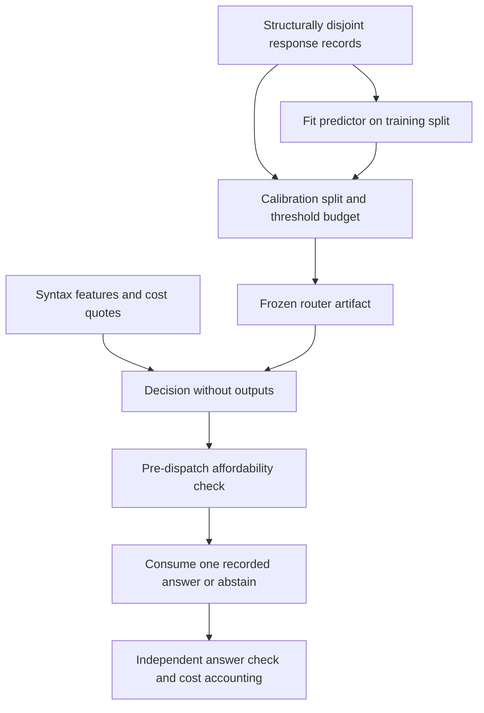

# Model Router

At a budget of 180 configured units, the recorded 36-case arithmetic fixture gives this result:

| Policy | Correct | Units spent |
| --- | ---: | ---: |
| Fixed small | 13/36 | 54 |
| Fixed large | 23/36 | 180 |
| Rule based | 23/36 | 180 |
| Learned router | 25/36 | 180 |
| Label-informed batch oracle | 33/36 | upper bound |

Those responses and costs are simulated. The logistic predictor and calibration are actually fitted, but the table is not a provider benchmark or a monetary-savings claim. Across five arrival orders, the frozen learned policy solved 24 to 27 cases at budget 180. At budget 40 it solved 5 to 8, while fixed-small solved 8 to 12. The learned policy does not win every regime.

## Decisions before answers

The batch router receives an expression's syntax features and pre-dispatch cost quotes. It cannot read the candidate outputs or the arithmetic answer. Expression structures are split into 108 training, 36 calibration, and 36 test records. Training fits a small-model success predictor; calibration fits probabilities and chooses a threshold under an explicit budget. Test labels enter evaluation only.

Before any recorded response is consumed, the selected quote must fit the remaining budget. Otherwise the policy chooses an affordable alternative or abstains. The exact batch oracle sees labels offline, buys the cheapest correct cases, and supplies an upper bound; it is not available to routing.



## Reproduce the batch experiment

Python 3.11+ and the standard library are enough.

```bash
python -m pip install -e .
python -m model_router demo --budget-units 180 --output artifacts/demo.json
python -m model_router evaluate --records policies/response_fixture.jsonl --router runs/router.json --budget-units 180 --output artifacts/evaluation.json
python -m model_router sweep --router runs/router.json --budget-units 180 --budgets 0 40 80 180 --orderings 5 --output artifacts/sensitivity.json
```

Generate and train a new fixture with `generate` and `train`. The versioned router records training/calibration hashes, structural group sets, and the threshold-selection budget. Loading an older schema-1 artifact fails rather than guessing its missing budget. The evaluator rejects declared train/test overlap.

Imported JSONL can instead contain `RECORDED` responses with exact model identity and timezone-qualified capture time. Keep `latency_ms` null unless measured. Integer `cost_units` express the chosen budget policy, not a currency conversion. Imports are bounded to 33,554,432 characters with per-line checks; router artifacts are capped at 1,048,576 characters. Duplicate JSON fields and nonfinite numbers are rejected. See the [record format and leakage rules](decisions/data-boundaries.md).

## A separate question: evaluating a fixed policy from action logs

The logged-bandit subsystem evaluates stateless per-request policies under individual cost caps. It does not apply one-step importance weights to the budget-coupled batch allocator.

```bash
python -m model_router bandit-demo --samples 1500 --seed 17 --epsilon 0.3 --folds 5 --output artifacts/bandit.json
python -m model_router bandit-evaluate --logs runs/bandit-logs.jsonl --policy adaptive --seed 17 --folds 5 --output artifacts/replayed-bandit.json
```

Only the chosen action's outcome reaches the estimator. IPS, SNIPS, and cross-fitted doubly robust estimates are compared with full-information synthetic truth outside estimation. The stored adaptive-policy run has truth 0.477333, IPS 0.470392, SNIPS 0.473689, DR 0.475168, and effective sample size 1,305.59. Unsupported target actions yield no estimate; low evidence makes the exported result unusable. Confidence intervals have the assumptions stated in [the estimator derivation](decisions/estimators-and-routing.md), not an unrestricted repeated-peeking guarantee.

## Reading and checking the code

| Path | Contents |
| --- | --- |
| `src/model_router/core.py` | fitting, calibration, budgets and batch comparisons |
| `src/model_router/bandit.py` | logging, support checks and off-policy estimators |
| `policies/` | reproducible response fixture |
| `runs/` | router coefficients, logs and executed reports |
| `test/` | isolation, budget, estimator and numeric regressions |
| `tools/probe_routing_edges.py` | selected source-fault probes in copies |

Run `python -m unittest discover -s test -v`, then `python tools/check_routing.py --require-lint --wheel` for repository checks. [Routing regressions](decisions/routing-regressions.md), [offline evaluation instructions](decisions/offline-evaluations.md), and [the check ledger](decisions/check-ledger.md) retain the evidence and its limits. No API collection or live model dispatch is performed here.
